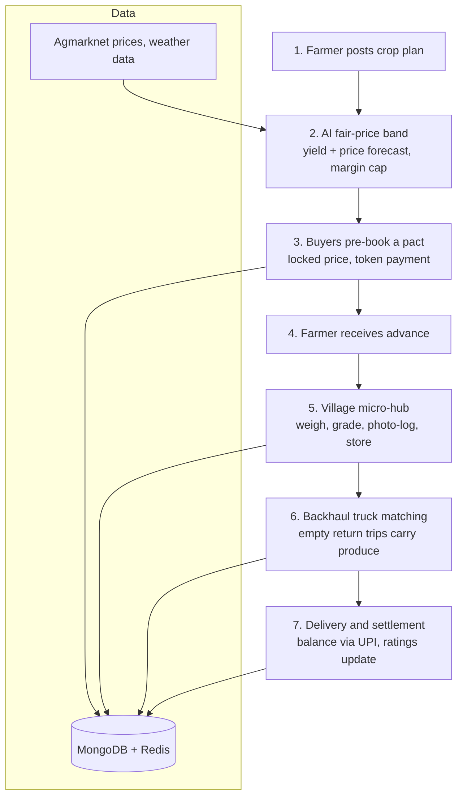

# Smart India Hackathon Workshop
# Date:29/10/2026
## Reference Number:26015690
## Name:GOPIKA SRI V

## Problem Title
SIH 26033: Multiple intermediaries reduce farmers earnings and increase consumer prices.

## Problem Creater's Organization
Ministry of Consumer Affairs, Food & Public Distribution

## Theme
Agriculture, FoodTech & Rural Development

## Problem Description
Expected Solution: Create a digital marketplace that:

• Connects farmers/FPOs directly with consumers and bulk buyers.
• Provides logistics support.
• Uses AI for demand forecasting and route optimization.

Benefits:

• Better prices for farmers.
• Lower prices for consumers.
• Reduced supply chain inefficiencies.

## Proposed Solution
HarvestPact: A Pre-Harvest Commitment Marketplace

HarvestPact lets buyers book produce *before* it is harvested, at a price locked inside an AI-generated fair-price band. Farmers get price certainty and working capital together, and the produce travels on trips that already exist.
### 1. Detailed explanation
1. **Crop plan:** A farmer or FPO posts a crop plan (crop, acreage, expected harvest date) weeks before harvest.
2. **Fair-price band:** The AI estimates likely yield and market price, then publishes a band. The *floor* guarantees the farmer a margin and the *ceiling* caps the consumer price.
3. **Pre-booking (the "pact"):** Consumers, retailers and bulk buyers reserve a share of the harvest by paying a small token (about 10-15%). The price is locked.
4. **Advance to the farmer:** The buyers' tokens are released to the farmer as an advance for seeds and inputs, so there is no need for a high-interest loan.
5. **Village micro-hub:** At harvest, produce goes to a local micro-hub run by an SHG or FPO member, where it is weighed, graded, photo-logged and stored.
6. **Backhaul logistics:** Trucks that delivered goods to rural areas and are returning empty carry the produce to buyers. The AI matches loads to these return trips.
7. **Settlement:** The buyer pays the balance by UPI on delivery, and ratings update on both sides.

## How It Addresses the Problem
- Traders earn mainly by financing farmers and controlling transport. The **advance** and **backhaul trucks** replace both roles.
- Selling at a locked price before harvest removes **distress selling** to local traders.
- The **margin cap** in the fair-price band keeps consumer prices down.
- Pre-booked demand tells farmers what to grow and sell, reducing **oversupply and waste**.

## Technical Approach
### 1. Technologies used

| Layer | Technology |
|---|---|
| Frontend | Next.js (App Router), TypeScript, Tailwind CSS, installable PWA, Leaflet maps |
| Backend | Next.js API routes (or NestJS), NextAuth with phone-OTP login |
| Database | MongoDB Atlas (2dsphere geospatial indexes), Redis (caching, pact-expiry timers) |
| AI / ML service | Python: LightGBM or Prophet for price and yield forecasting (quantile forecasts for the price band); Google OR-Tools for load-to-return-trip matching |
| Integrations | Razorpay (UPI, test mode for prototype), SMS gateway, OpenStreetMap-based routing |
| DevOps | Docker, GitHub Actions, Vercel plus a small container host |

### 2. Methodology and process

**Implementation steps**

1. Build the farmer crop-plan form and the buyer pre-booking flow.
2. Add the fair-price band (start with a simple statistical model).
3. Add the pact lifecycle: token, advance, balance (Razorpay test mode).
4. Add micro-hub grading logs and the backhaul matching view.
5. Test with sample data from one district and two crops, then pilot.

### Working prototype (planned screens)

1. Farmer crop plan with its fair-price band.
2. Buyer pre-booking page with a "price locked" status.
3. Pact timeline showing the stages in the flow chart above.

## Feasibility and Viability
## 1. Feasibility

- **Technical:** All tools are open source or have free tiers, and the price data is publicly available.
- **Economic:** Revenue comes from a small pact fee, a hub handling fee and bulk-buyer subscriptions. The advance is funded by buyers' tokens, so the platform does not need lending capital.
- **Operational:** Start with FPO members in one district and a few crops, then scale.

### 2. Potential challenges and risks

- Crop failure from weather or pests.
- Buyer or farmer default on a pact.
- Forecast errors that make the price band unfair.
- Finding enough backhaul trucks.
- Farmers' reluctance to commit early.
- Low digital literacy and poor connectivity.

### 3. Strategies for overcoming these challenges

| Challenge | Strategy |
|---|---|
| Crop failure | Allow partial fulfilment, pool several farmers' harvests under one FPO pact, optional crop insurance linked to PMFBY |
| Default | Non-refundable token for defaulting buyers, reliability scores for farmers |
| Forecast error | Regular retraining, wider band when uncertainty is high |
| Truck supply | Start with return trips of agri-input and FMCG transporters, tie up with truck-owner associations |
| Early commitment | Begin with organised FPO members who already trust the group |
| Literacy / connectivity | Regional-language, voice-assisted PWA with offline drafts and SMS fallback; FPO coordinators as onboarding agents |

---

## Impact and Benefits

### 1. Potential impact on the target audience

- **Farmers / FPOs:** price certainty, an advance without debt, less distress selling.
- **Consumers:** lower, capped prices and predictable supply.
- **Bulk buyers:** assured supply and planned sourcing.
- **Government:** early visibility into expected supply, useful for price stabilisation.

### 2. Benefits

- **Social:** jobs for SHG members at micro-hubs, less dependence on moneylenders.
- **Economic:** lower transport cost through backhaul, a smaller gap between farm-gate and consumer price.
- **Environmental:** fewer extra truck trips and less spoilage because production matches pre-booked demand.

### Measurable indicators (to verify in a pilot)

- Farmer net realisation per kg.
- Consumer saving per kg.
- Transport cost per order and share of backhaul loads.
- Share of pacts fulfilled.
- Produce lost or rejected (%).
- Days to farmer settlement.

---

## Research and References

### A. Evidence that the problem is real

1. Roy, Gupta, Wardhan, Sarkar, Tewari, Bansal, Bhatia and Gulati (2024). *Vegetables Inflation in India: A Study of Tomato, Onion and Potato (TOP).* RBI Working Paper No. 08/2024.
   https://rbi.org.in/scripts/PublicationsView.aspx?id=22723
   Farmers receive about 33% (tomato), 36% (onion) and 37% (potato) of the consumer price. The paper also shows that price spikes can be forecast with a supply-demand balance-sheet approach, and recommends stronger farmer collectives and wider use of e-NAM.
2. Gulati, Ganguly and Wardhan (eds.). *Agricultural Value Chains in India.* Springer (ICRIER-NABARD).
   https://link.springer.com/book/10.1007/978-981-33-4268-2

### B. Existing platforms and the gap

3. PIB (13 April 2026). *e-NAM: Digital Transformation of Agricultural Trade in India.*
   https://static.pib.gov.in/WriteReadData/specificdocs/documents/2026/apr/doc2026413845801.pdf
   By March 2026, e-NAM had integrated 1,656 mandis, with over 1.80 crore farmers and 4,724 FPOs registered.
   **Gap:** produce must still be brought physically to the mandi, and there is no pre-harvest booking, advance or door-to-buyer logistics.
4. Agmarknet (mandi price data): https://agmarknet.gov.in
5. ONDC: https://ondc.org
6. Kisan Rath (Ministry of Agriculture transport-matching app)

### C. Backhaul logistics

7. KPMG in India commentary (Business Today, 28 Jan 2026), *Logistics costs to GDP: Can Budget 2026 finally move the needle?*
   https://www.businesstoday.in/union-budget/opinion/story/logistics-costs-to-gdp-can-budget-2026-finally-move-the-needle-513228-2026-01-28
   Cites 25-30% empty return trips for Indian trucks. Other industry estimates go up to about 35%, so figures vary.
8. YourStory (March 2025), *Logistics matchmaking: With AI, TrucksUp is fixing India's empty miles problem.*
   https://yourstory.com/2025/03/uber-for-logistics-ai-trucksup-gurugram-startup-cargo-matching-trucks
   Shows AI return-load matching already operating in India.
9. World Bank, review of empirical evidence on empty trips and backhaul.
   https://openknowledge.worldbank.org/bitstreams/21fa86af-2717-4438-a305-5af6881f3b4a/download
   Reports cases where better matching technology lowered empty-trip shares by 4-5 percentage points.
10. NITI Aayog and RMI India, *A Roadmap for Clean and Cost-Effective Goods Transport.*

### D. Technical and policy references

11. Prophet: https://facebook.github.io/prophet/
12. LightGBM: https://lightgbm.readthedocs.io
13. Google OR-Tools (vehicle routing): https://developers.google.com/optimization/routing
14. Next.js: https://nextjs.org/docs
15. MongoDB geospatial queries: https://www.mongodb.com/docs/manual/geospatial-queries/
16. Razorpay docs: https://razorpay.com/docs/
17. Central Sector Scheme for Formation and Promotion of 10,000 FPOs (SFAC, Ministry of Agriculture & Farmers Welfare)
18. Pradhan Mantri Fasal Bima Yojana (PMFBY): https://pmfby.gov.in
19. Model Contract Farming Act, 2018 (Ministry of Agriculture & Farmers Welfare)

